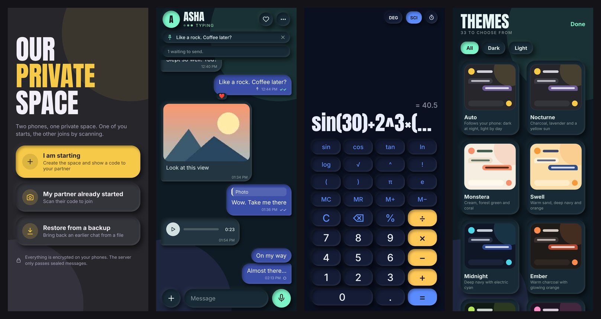
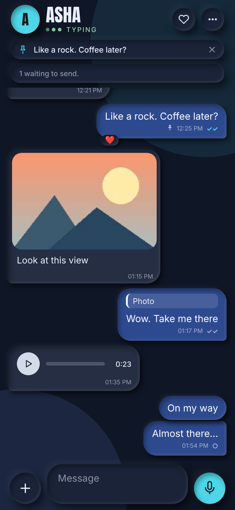
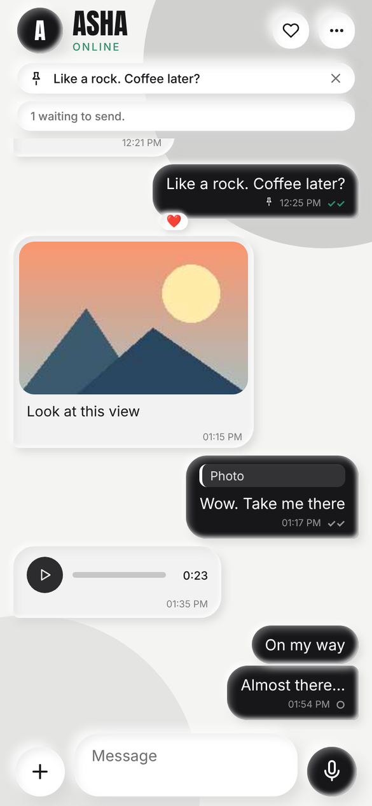
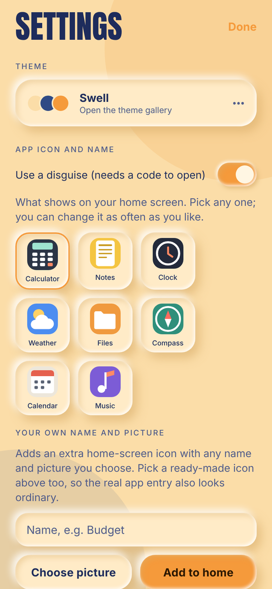
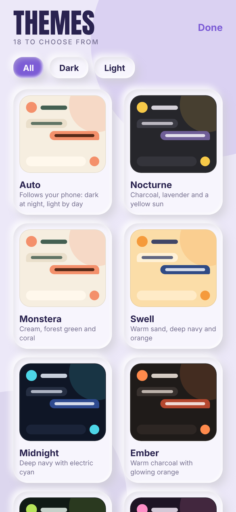

# Reva

A private, end-to-end encrypted chat for two people. On the phone it looks like an ordinary utility app
(Calculator, Notes and more). Reva's name never appears on the phone. Everything it uses is free:
Oracle's Always Free server, DuckDNS, Let's Encrypt, Firebase's free push, and your own Google Drive.

## Screenshots



These are the real screens rendered in a browser at phone size with made-up sample messages. They are not photos
from a phone, so fonts and shadows can differ slightly on a device.

| Chat, Midnight | Chat, Paper | Settings |
|---|---|---|
|  |  |  |

| Theme gallery | Calculator disguise | Shared notes | Starred |
|---|---|---|---|
|  |  |  |  |

To make them again: `cd app && EXPO_PUBLIC_PREVIEW=1 npx expo export --platform web`, serve the output folder, and open
`?screen=chat&theme=nocturne` (other screens: `settings`, `themes`, `calc`, `notes`, `setup`, `starred`, `sharednotes`).

## Features

**Chat**
- Real-time text, sent / delivered / read ticks, typing indicator, instant reconnect after a network change
- Offline queue: messages written without signal go out by themselves, in order, even after the app restarts
- Swipe to reply, reactions, edit and delete for both, search
- Pinned messages (shown at the top), starred messages (private to your phone, with their own list)
- Disappearing messages: off, 1 hour, 1 day or 1 week
- Quick "thinking of you" heart
- Voice notes (up to 2 minutes), encrypted like everything else
- Pictures from the gallery or camera: shrunk, location removed, encrypted on the phone, pinch-to-zoom viewer,
  an explicit **Save to gallery** button (default off, switchable), and **view once**
- Shared notes you both see and edit (newest edit wins)
- Day separators, grouped bubbles, animated typing dots

**Bring your old chat**
- **Import a WhatsApp chat** from "Export chat" (text, or zip with photos). Handles Android and iPhone layouts,
  12 and 24 hour clocks, day-first and month-first dates. Importing twice makes no duplicates.
- The import is **synced to your partner's phone** (encrypted, in small batches). If both of you import the same
  chat, it lines up and nothing doubles.
- **Export** your chat back to a text file.

**Disguise**
- Two fully working disguises (Calculator, Notes) and six more icons and names: Clock, Weather, Files, Compass,
  Calendar, Music. Switch any time in Settings. Add more in `app/config/disguises.js`.
- Your own home-screen shortcut with any name and picture.
- Open with a code: Calculator, code then `=`. Notes, code in the search box (or as a note title).
- A decoy code opens a fake empty chat. An optional wipe code erases the phone.
- Locks itself when you leave. Screenshots, screen recording and the recent-apps picture are blocked.

**Look**
- Soft "clay" style, smooth springs and fades, big headline type.
- **Theme gallery**: 18 themes (dark and light) with live previews, an Auto mode, and an accent colour you can
  lay over any of them. Every theme is built from a few base colours and checked by an automatic contrast test.
- The design is checked in a real browser: `EXPO_PUBLIC_PREVIEW=1 npx expo export --platform web` builds a preview
  of the real screens with sample data (not part of the phone app).

**First install, wipe and setup**
- On first install the icon and name are **"Reva"** and the app opens straight into setup. Once setup is done
  the launcher switches to your chosen disguise (Calculator by default).
- After a **wipe** the app is a plain Calculator again and shows nothing about itself. To set up again, hold the `=`
  key for about 1.5 seconds (Notes disguise: type `::setup` in the search box and press search).
- Android's back button goes back one screen. Opening the photo picker, camera or file picker does not lock the app.
- Five wrong codes in a row make the app ignore codes for a while (30 seconds, then longer).

**No cover mode**
- Turn the disguise off in Settings and the app opens straight into the chat, with a plain "Chat" icon.

**Safety of your data**
- Updates keep your messages: the app only ever adds to its database (there is a test for this), and updates
  are signed with the same key. You must keep that key. Without it Android refuses to install updates over the app.
- **Backup to Google Drive**: one encrypted file (messages, notes, keys, optionally pictures) protected by your
  passphrase, saved to Drive through the phone's Share menu. **Restore** from the first setup screen or Settings.
- The server also makes an encrypted daily copy of its own database.

**Notifications**
- Free push through Firebase. The notification is only a plain "Calculator: Tap to open". No names, no text.
  See `docs/PUSH-SETUP.md`.

**Updates**
- Settings has a **Check for updates** button that downloads a newer app from your own server.

## Security design

- libsodium-compatible crypto. Each phone has one 32-byte secret; signing and encryption keys come from it.
- Messages use `crypto_box`-style encryption (X25519 + XSalsa20-Poly1305). Typing, receipts, edits, deletes,
  reactions, pictures and voice notes are all inside the encrypted envelope. The server sees only sizes and timing.
- Phones log in by signing a fresh challenge with their device key. No passwords.
- Exactly two device keys are ever accepted. Pairing is by QR code on both phones (camera or gallery picture).
- The phone's database is encrypted (SQLCipher); keys live in the Android Keystore-backed secure store.
  Passcodes are stored only as slow salted hashes.
- Failed logins are rate limited and blocked. No analytics. No message content in any log.
- Compare the **safety number** in Settings on both phones. If it differs, the pairing was tampered with.

## Folders

| Folder | What it is |
|---|---|
| `shared/` | Encryption, wire format and the connection engine (offline queue, reconnect). |
| `server/` | Node.js + TypeScript relay: WebSocket, SQLite, rate limiting, push, backups. |
| `app/` | React Native (Expo) Android app. |
| `app/config/disguises.js` | The list of disguises. |
| `app/plugins/withDisguise.js`, `app/modules/disguise/` | Launcher icon and name switching, home-screen shortcut, save to gallery. |
| `deploy/` | Docker, Caddy (HTTPS), the one-command installer, update publishing, backup restore, laptop test. |
| `tools/` | Maven mirror for flaky networks, server bundle maker, Oracle server creation script. |
| `docs/` | `SERVER-SETUP.md` (Oracle, step by step), `PUSH-SETUP.md` (free notifications). |

## Tests

```bash
cd server && npm install && npm test        # encryption, two-device delivery, offline queue, reconnect,
                                            # pictures through the server, backups, push, update downloads
cd app && npm install && npx tsx --test test/*.test.ts
                                            # calculator, WhatsApp parser, phone crypto vs real libsodium,
                                            # backup file, database upgrade keeps old messages
```

## Build the Android app

```bash
cd app && npm install
npx expo prebuild --platform android
cd android && ./gradlew assembleRelease -PreactNativeArchitectures=arm64-v8a
```

If Maven Central answers `429`/`404` at random, start the mirror first:
`NODE_USE_ENV_PROXY=1 node tools/maven-mirror.mjs 8899 &` and add `-I ../../tools/mirror.init.gradle`.

For push, put your Firebase `google-services.json` in `app/` (it is git-ignored) before building.
Release builds are signed with a private key kept **outside** this repository.

## Honest status

Tested by automated tests: encryption, pairing rules, delivery, receipts, offline queue, reconnect,
large pictures through the server, backup file, push wake-up (against a fake Firebase), the WhatsApp parser,
the database upgrade, the phone crypto against real libsodium.

Written and built, but only checked by hand on a phone as far as you have tried them: the screens, QR scanning,
launcher icon switching, screenshot blocking, the update installer, picture and voice handling, backup
and restore, import of a real WhatsApp export, push on a real phone. Android launchers can take a few seconds
to show a new icon or name after switching.

## Server hosting notes

- Runs in its own Docker container with its own database, secrets and subdomain, sharing nothing with other apps.
- Oracle Always Free servers can be reclaimed when idle. Upgrade the Oracle account to Pay As You Go while staying
  inside the free limits, set a $1 budget alert, and keep copies of anything important off the server.
