# Reva


**A private, end-to-end encrypted chat for exactly two people, that looks like an ordinary phone utility.**

On the home screen it is a Calculator (or Notes, Clock, Weather and more). Type your secret code and press `=`, and it opens
your private chat with a partner: messages, photos, voice notes, voice calls, shared notes, albums, stickers and your
own themes. Your server, your keys, your data. There are no accounts, no phone numbers, no ads and no analytics.


> **Status:** an early, personal project, built for one couple and shared as it is. It is **not independently audited**
> and has been tried on a small number of real phones. Read [Security](#security) and [Honest status](#honest-status)
> before trusting it with anything that matters.

## Why Reva

- **Two people, one server you own.** The server accepts exactly two device keys. It only passes sealed messages along and
  cannot read them. It runs free forever on Oracle's Always Free tier (a Raspberry Pi or any small Linux box works too).
- **It hides in plain sight.** Calculator, Notes, Clock, Weather, Files, Compass, Calendar or Music icon and name; a real,
  working scientific calculator; a decoy code that opens a fake empty chat; a wipe code that erases the phone.
- **Free.** Oracle Always Free, DuckDNS, Let's Encrypt, Firebase's free push and your own Google Drive for backups.
- **Made to feel good.** Soft "clay" design, 33 themes, WhatsApp-style ticks, swipe to reply, an alarm-clock call screen.

## How it works

```
 phone A  ──(sealed with phone B's key)──▶  your server  ──▶  phone B
  │            the server sees sizes and timing only             │
  └────────────  voice calls go phone to phone (WebRTC)  ────────┘
                 through your own relay only if the networks block that
```

1. One phone starts a private space on your server and shows a QR code. The other phone scans it. Done: the server
   now accepts only those two keys.
2. Every message, picture, voice note and call setup is encrypted on the sending phone (X25519 + XSalsa20-Poly1305,
   libsodium-compatible) and can only be opened by the other phone.
3. The phone's own database is encrypted too, and the secret keys live in the Android Keystore.

## Get your own

You need: an Android phone each, a free Oracle Cloud account (or any small Linux server), and a free DuckDNS name.
No coding needed to install; the steps are written for non-technical people.

1. **Server:** follow [`docs/SERVER-SETUP.md`](docs/SERVER-SETUP.md). One command installs everything (Docker, HTTPS, the chat
   server and the call relay). No Oracle capacity? See [`docs/ORACLE-ON-PI.md`](docs/ORACLE-ON-PI.md).
2. **App:** build the APK yourself (see [Build the Android app](#build-the-android-app)), or ask whoever runs your server
   to. There is no hosted service and no central app store listing.
3. **Push notifications (optional, free):** [`docs/PUSH-SETUP.md`](docs/PUSH-SETUP.md).
4. **Pair:** first phone "I am starting", second phone scans its QR code. Compare the **safety number** in Settings.

## Screenshots


These are the real screens rendered in a browser at phone size with made-up sample messages. They are not photos
from a phone, so fonts and shadows can differ slightly on a device.

### First run
| Start | Choose your codes |
|---|---|
| 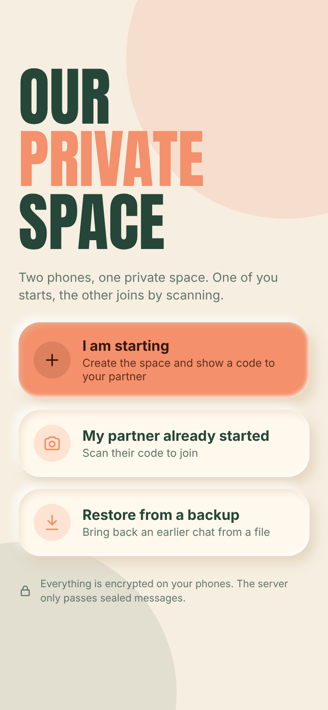 | 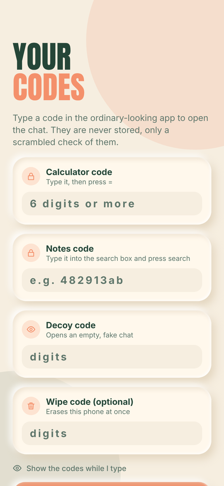 |

### Chat
Voice notes with a waveform, photos with the time on the picture, a typing bubble, an online dot, quote-jumping,
a jump-to-latest button, and one round button that turns from a microphone into a send arrow as you type.

| Nocturne | Aurora (typing, disappearing on) | Glacier | Lemonade | A new chat |
|---|---|---|---|---|
| 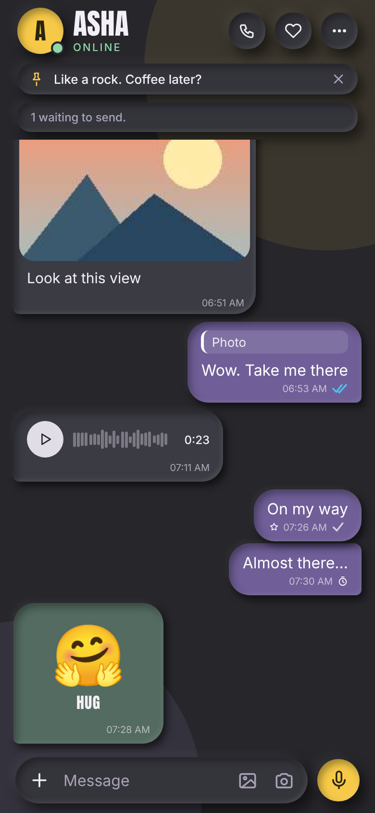 |  |  | 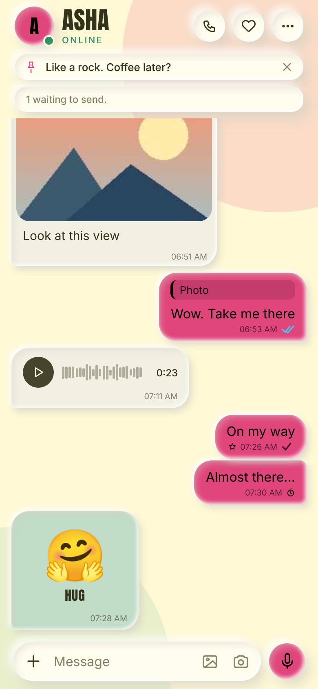 | 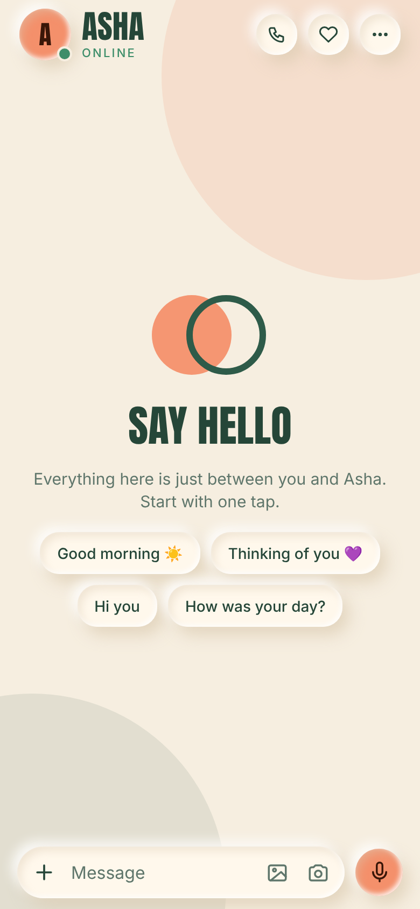 |

### Days together, photo albums and stickers
| Our days (shared with your partner) | Photos and albums | Stickers | A sticker in the chat |
|---|---|---|---|
|  | 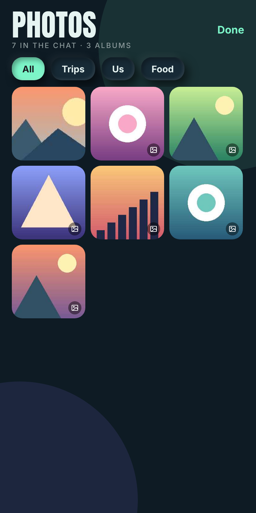 |  |  |

### Voice calls (dressed up as a clock)
| Someone calls: a ringing alarm | In a call: a timer |
|---|---|
| 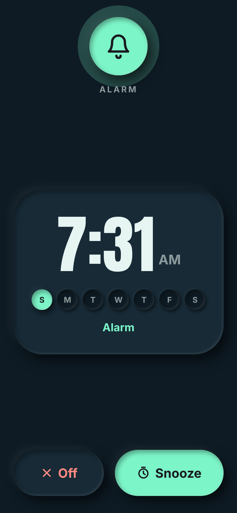 |  |

### 33 themes
The same chat in twelve of them:


| Theme gallery | The whole gallery |
|---|---|
| 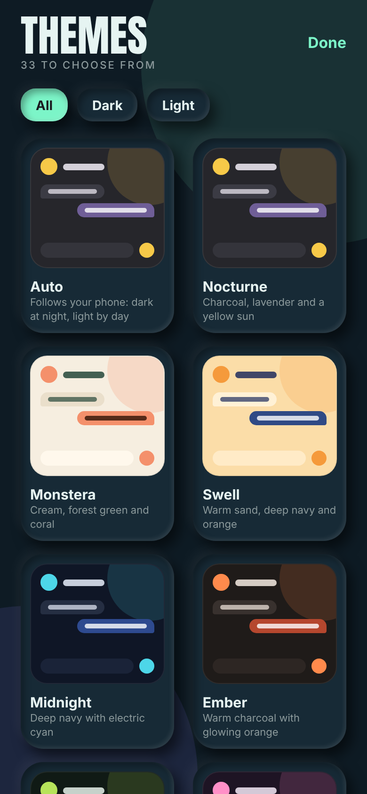 | 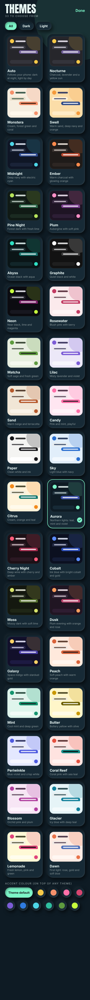 |

Dark: Nocturne, Midnight, Ember, Pine Night, Plum, Abyss, Graphite, Neon, Aurora, Cherry Night, Cobalt, Moss, Dusk, Galaxy.
Light: Monstera, Swell, Rosewater, Matcha, Lilac, Sand, Candy, Paper, Sky, Citrus, Peach, Mint, Butter, Periwinkle,
Coral Reef, Blossom, Glacier, Lemonade, Dawn. Plus **Auto**, which follows your phone, and an accent colour you can
lay over any of them.

### The calculator disguise
| Everyday | Scientific (sin, cos, tan, ln, log, powers, brackets, memory, history) |
|---|---|
| 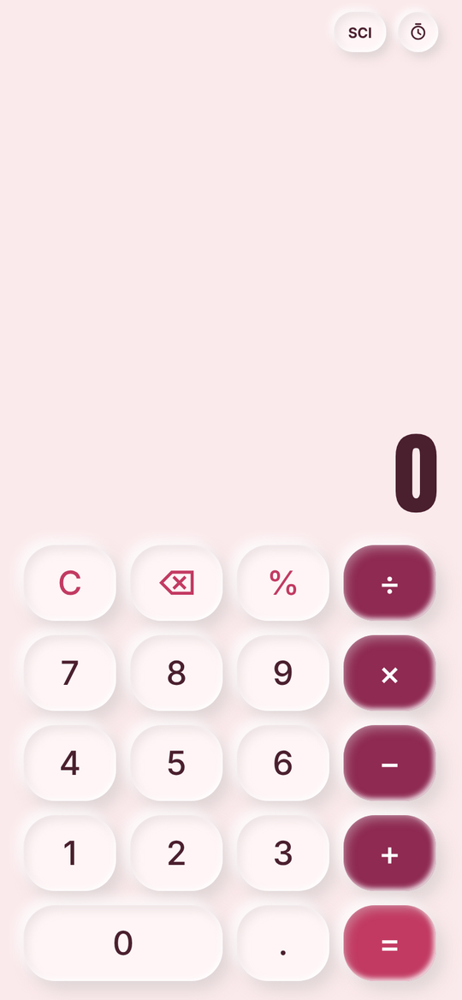 | 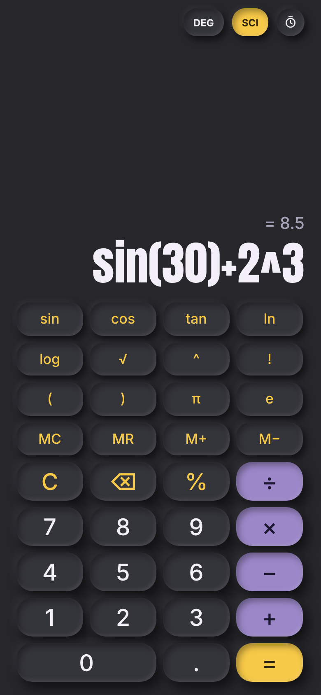 |

### Settings and tools
| Settings (grouped cards, profile at the top) | Backup and restore | Import a WhatsApp chat |
|---|---|---|
| 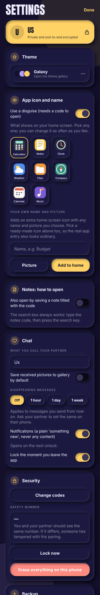 | 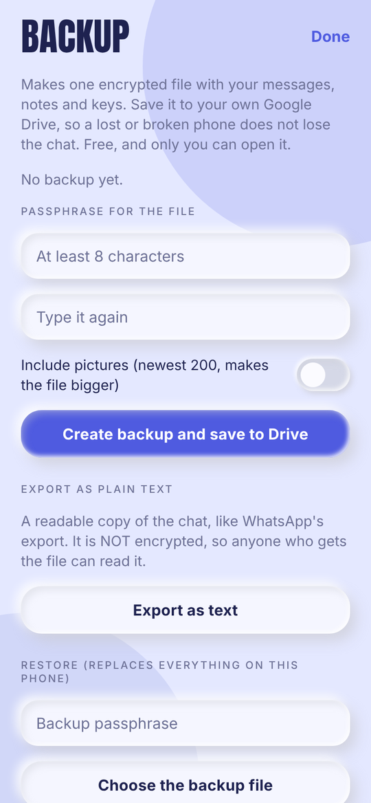 |  |

| Shared notes | Starred messages | The Notes disguise |
|---|---|---|
|  |  |  |

To make them again: `cd app && EXPO_PUBLIC_PREVIEW=1 npx expo export --platform web`, serve the output folder, and open
`?screen=chat&theme=aurora` (other screens: `settings`, `themes`, `calc` with `&sci=1&expr=...`, `notes`, `setup`,
`setupcodes`, `starred`, `sharednotes`, `import`, `backup`).

## Features

**Chat**
- Real-time text, sent / delivered / read ticks, typing indicator, instant reconnect after a network change
- Offline queue: messages written without signal go out by themselves, in order, even after the app restarts
- Swipe to reply, reactions, edit and delete for both, search
- Pinned messages (shown at the top), starred messages (private to your phone, with their own list)
- Disappearing messages: off, 1 hour, 1 day or 1 week
- **Days together**: set the day you started once and both phones count the same days. A ring shows progress to the next
  milestone (50, 100, 200 ... 1000 and on), the years-months-days, and the next anniversary. "Day N" shows in the chat header.
- **Photo albums**: every photo in one grid, plus albums you and your partner make together ("Trips", "Us"). Press and
  hold a photo to choose its albums.
- **Stickers**: 40 stickers in four packs (Love, Daily, Moods, Fun). They take the colours of your theme, and only a tiny
  id is sent, so they cost no data.
- **Photos and Camera buttons right in the message box** (like WhatsApp; they step aside while you type)
- Quick "thinking of you" heart
- **Voice calls** (the phone button in the chat header). An incoming call shows as a ringing **alarm**: **Snooze** answers,
  **Off** declines. A call in progress looks like a **timer** with Mute, Speaker and Stop. The sound goes phone to phone
  (WebRTC, encrypted); when the networks do not allow that, it goes through your own free relay (coturn) on the server.
  Calls end up as a line in the chat ("Voice call 2:31", "Missed voice call"). A call keeps going when you leave the app or lock
  the screen (a plain "Timer · Running" notification shows while it lasts), and a call offer wakes the other phone with a
  plain "Alarm: Tap to open" notification when push is set up.
- Voice notes (up to 2 minutes), encrypted like everything else
- Pictures from the gallery or camera: shrunk, location removed, encrypted on the phone, pinch-to-zoom viewer,
  an explicit **Save to gallery** button (default off, switchable), and **view once**
- Shared notes you both see and edit (newest edit wins)
- Day separators, grouped bubbles, animated typing dots
- WhatsApp-style ticks on every message you send: one grey tick = sent, two grey = delivered, two **blue** = read
- Easy replies: swipe a message to the right (a reply arrow appears, the phone buzzes at the right spot) or press and hold,
  and the keyboard opens at once with a clear "Replying to ..." bar above the box

**Bring your old chat**
- **Import a WhatsApp chat** from "Export chat" (text, or zip with photos). Handles Android and iPhone layouts,
  12 and 24 hour clocks, day-first and month-first dates. Importing twice makes no duplicates.
- The import is **synced to your partner's phone** (encrypted, in small batches). If both of you import the same
  chat, it lines up and nothing doubles.
- **Export** your chat back to a text file.

**Disguise**
- The calculator is a real one: brackets, powers, roots, factorial, sin/cos/tan in degrees or radians, ln and log, π and e,
  memory keys and a history list.
- Two fully working disguises (Calculator, Notes) and six more icons and names: Clock, Weather, Files, Compass,
  Calendar, Music. Switch any time in Settings. Add more in `app/config/disguises.js`.
- Your own home-screen shortcut with any name and picture.
- Open with a code: Calculator, code then `=`. Notes, code in the search box (or as a note title).
- **Fingerprint unlock** as an extra way in (Settings, Security): hold the `=` key on the calculator, or the "Notes" title in
  the Notes disguise, and touch the sensor. Fingerprint only (no phone PIN fallback), and the prompt just says "Confirm".
  Anyone whose fingerprint is saved on the phone can use it, so turn it on only if that suits you.
- A decoy code opens a fake empty chat. An optional wipe code erases the phone.
- Locks itself when you leave. The recent-apps picture is hidden (Android 13 and newer; older phones shield the window
  while the app is not in front). **Screenshots are allowed** (so you can share your pairing code), except while a **view-once**
  picture is open: those cannot be captured.

**Look**
- Soft "clay" style, smooth fades with no bounce, big headline type.
- **Theme gallery**: 33 themes (dark and light) with live previews, an Auto mode, and an accent colour you can
  lay over any of them. Every theme is built from a few base colours and checked by an automatic contrast test.
- The design is checked in a real browser: `EXPO_PUBLIC_PREVIEW=1 npx expo export --platform web` builds a preview
  of the real screens with sample data (not part of the phone app).

**First install, wipe and setup**
- On first install the icon and name are **"Reva"** and the app opens straight into setup. Once setup is done
  the launcher switches to your chosen disguise (Calculator by default).
- After a **wipe** the app is a plain Calculator again and shows nothing about itself. To set up again, hold the `=`
  key for about 1.5 seconds (Notes disguise: type `::setup` in the search box and press search).
- Android's back button goes back one screen. Opening the photo picker, camera or file picker does not lock the app.
- Five wrong codes in a row make the app ignore codes for a while (30 seconds, then longer).

**No cover mode**
- Turn the disguise off in Settings and the app opens straight into the chat, named **Reva**, with its own icon (two chat
  bubbles and a heart).

**Safety of your data**
- Updates keep your messages: the app only ever adds to its database (there is a test for this), and updates
  are signed with the same key. You must keep that key. Without it Android refuses to install updates over the app.
- **Backup to Google Drive**: one encrypted file (messages, notes, keys, optionally pictures) protected by your
  passphrase, saved to Drive through the phone's Share menu. **Restore** from the first setup screen or Settings.
- The server also makes an encrypted daily copy of its own database.

**Notifications**
- Free push through Firebase. The notification is only a plain "Calculator: Tap to open". No names, no text.
  See `docs/PUSH-SETUP.md`.

**Updates**
- Settings has a **Check for updates** button that downloads a newer app from your own server.

## Security

What it protects, and what it does not:

- **End-to-end encryption.** Messages, pictures, voice notes, edits, reactions, receipts and call setup are sealed on
  the phone with libsodium-compatible crypto (X25519 + XSalsa20-Poly1305). Each phone has one 32-byte secret from which
  the signing and encryption keys are derived.
- **No passwords, no accounts.** Phones log in by signing a fresh challenge with their device key. Exactly two device keys
  are ever accepted. Failed logins are rate limited and blocked. No analytics, no message content in any log.
- **Safety number.** Compare it in Settings on both phones; if it differs, the pairing was tampered with.
- **On the phone.** The database is encrypted (SQLCipher), keys sit in the Android Keystore-backed secure store, passcodes
  are stored only as slow salted hashes, the app locks itself when you leave and hides its picture in the recent-apps list.
  View-once pictures cannot be screenshotted.
- **Calls.** Voice goes phone to phone (WebRTC, encrypted with DTLS-SRTP). If the networks block that, it goes through your
  own coturn relay, which only forwards encrypted packets and uses short-lived logins.
- **Not protected:** a phone that is unlocked in someone's hand; a phone with malware; the fact that two devices talk to
  your server (the server sees sizes and timing); Android's own backups of other apps. The disguise is meant to stop a
  casual look, not a forensic examination.
- **Not audited.** The cryptography is built from well-known libraries, and automated tests compare it with real
  libsodium, but nobody independent has reviewed this code. Please do not rely on it for anything life-critical.

**Found a vulnerability?** Please read [`SECURITY.md`](SECURITY.md) and report it privately.

**Never commit secrets** if you fork this: signing keys, `google-services.json`, Firebase service-account files, server
`.env` files, setup codes and pairing QR codes. The `.gitignore` already blocks the usual ones.

## Folders

| Folder | What it is |
|---|---|
| `shared/` | Encryption, wire format and the connection engine (offline queue, reconnect). |
| `server/` | Node.js + TypeScript relay: WebSocket, SQLite, rate limiting, push, backups. |
| `app/` | React Native (Expo) Android app. |
| `app/config/disguises.js` | The list of disguises. |
| `app/plugins/withDisguise.js`, `app/modules/disguise/` | Launcher icon and name switching, home-screen shortcut, save to gallery. |
| `deploy/` | Docker, Caddy (HTTPS), the one-command installer, update publishing, backup restore, laptop test. |
| `tools/` | Maven mirror for flaky networks, server bundle maker, Oracle server creation script. |
| `docs/` | `SERVER-SETUP.md` (Oracle, step by step), `PUSH-SETUP.md` (free notifications), `ORACLE-ON-PI.md` (getting the Oracle server using a Raspberry Pi). |

## Tests

```bash
cd server && npm install && npm test        # encryption, two-device delivery, offline queue, reconnect,
                                            # pictures through the server, backups, push, update downloads
cd app && npm install && npx tsx --test test/*.test.ts
                                            # calculator, WhatsApp parser, phone crypto vs real libsodium,
                                            # backup file, database upgrade keeps old messages
```

## Build the Android app

```bash
cd app && npm install
npx expo prebuild --platform android
cd android && ./gradlew assembleRelease -PreactNativeArchitectures=arm64-v8a
```

If Maven Central answers `429`/`404` at random, start the mirror first:
`NODE_USE_ENV_PROXY=1 node tools/maven-mirror.mjs 8899 &` and add `-I ../../tools/mirror.init.gradle`.

For push, put your Firebase `google-services.json` in `app/` (it is git-ignored) before building.
Release builds are signed with a private key kept **outside** this repository.

## Honest status

- Tested by automated tests (56 on the app, 25 on the server): encryption, pairing rules, delivery, receipts, offline
  queue, reconnect, large pictures through the server, backup file, push wake-up (against a fake Firebase), the WhatsApp
  parser, the database upgrade, the phone crypto against real libsodium, the call logic with fake connections.
- Tried on real phones by the author: pairing, messaging, themes, the disguise, photos.
- **Not yet verified on two real phones:** voice call audio quality, the call relay, calls in the background, Bluetooth
  headset routing, push notifications, and importing very large WhatsApp exports (a memory crash on big zips was fixed but not re-tested). They are built and unit tested, and
  they may have bugs. Issues and reports are welcome.
- Android only. There is no iPhone version.
- Calls need the Oracle security list to allow **UDP 3478, TCP 3478 and UDP 49160-49200** (see `docs/SERVER-SETUP.md`).

## Contributing

Bug reports and ideas are welcome as GitHub issues. This is a personal project, so replies may take a while. Please do
not post real chats, screenshots of your own app, server addresses or setup codes in issues.

## Credits

Built with Expo / React Native, libsodium and tweetnacl, SQLCipher, react-native-webrtc, coturn, Caddy and Node.js.
Design inspired by claymorphism. WhatsApp is a trademark of its owner; Reva is not affiliated with or endorsed by WhatsApp or Meta.

## Server hosting notes

- Runs in its own Docker container with its own database, secrets and subdomain, sharing nothing with other apps.
- Oracle Always Free servers can be reclaimed when idle. Upgrade the Oracle account to Pay As You Go while staying
  inside the free limits, set a $1 budget alert, and keep copies of anything important off the server.
